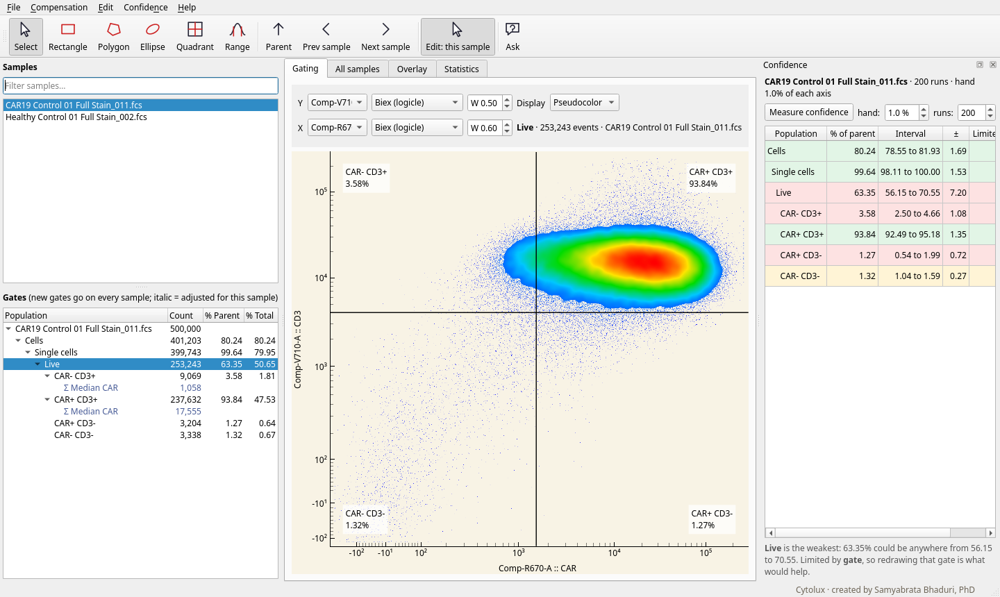

# Cytolux

A desktop app for looking at and gating flow cytometry data (FCS 2.0/3.0/3.1). Local only.

A gated percentage is a count divided by a line somebody drew with a mouse. Cytolux
puts a confidence interval on every one, and says whether the gate or the event count
is what limits it.

*CAR19 product control tube from the public Good et al. 2022 dataset. Right: each
population's interval, from 200 re-gatings with every boundary moved by about 1% of
the axis, combined with counting error. Live is the weakest gate here, 63.35% with an interval of 56.15 to 70.55.*

## Install

Download the file for your platform from the
[latest release](https://github.com/sitarboston/cytolux/releases/latest).

| Platform | File | What to do |
|---|---|---|
| Windows 10/11, 64-bit | `Cytolux-*-windows-x64-setup.exe` | Run it. It installs for your user only, so it never asks for an administrator password. SmartScreen will say the publisher is unknown: More info, then Run anyway. |
| macOS, Apple silicon | `Cytolux-*-macos-arm64.dmg` | Open it, drag Cytolux to Applications. First launch: right-click the app, then Open. |
| Linux, x86_64 | `Cytolux-*-x86_64.AppImage` | `chmod +x Cytolux-*.AppImage`, then run it. Run it once with `--install` to add it to the applications menu. |

Neither the Windows nor the macOS build is code-signed, which is why both warn on
first launch. Every file has a matching `.sha256`.

**From this source tree instead:** `./install.sh` adds the applications-menu entry,
the icons, a `cytolux` command and the `.fgw` and `.fcs` file associations. It runs
the app out of the checkout, so `git pull` updates it. `./install.sh --uninstall` reverses it.

**Start:** Cytolux in the applications menu, `cytolux [workspace.fgw | fcs_folder]`,
or `~/cytolux/cytolux.sh`. Press F1 in the app for the quick guide.

## Test data: three FCS files are in this repository

**You do not need to find your own data to try this.** Three FCS files ship in
[`testdata/`](testdata/), so a fresh clone has something to open immediately:

| File | Events |
|---|---|
| [`testdata/5019_123.fcs`](testdata/5019_123.fcs) | 21,470 |
| [`testdata/5019_125.fcs`](testdata/5019_125.fcs) | 27,755 |
| [`testdata/5019_154.fcs`](testdata/5019_154.fcs) | 26,302 |

Patient samples from the axi-cel cohort in Good et al., *Nature Medicine* 2022,
acquired on a BD LSRII and released by the authors into the public domain (ODC
PDDL 1.0). 25 parameters, with CAR, CD3, CD4, CD8, CD25, FOXP3, Helios and a
viability dye among the labels. `SPILL` is in every file, so compensation from file
works with no setup.

Open all three at once:

    cytolux testdata/

[`testdata/README.md`](testdata/README.md) gives the citation, the full panel, the
checksums, and a gate template to start from.

## What it does

- Pseudocolor, dot and histogram plots; Linear, Log and Biex (logicle) axes, biex width set from the data.
- Rectangle, polygon, ellipse, quadrant and range gates; drag to edit; gate tree with counts, % parent, % total.
- One gate tree for all samples, with per-sample adjustments where needed.
- Compensation from the FCS file (FlowJo "acquisition-defined"), a CSV matrix, or edited by hand.
- Import FlowJo 10 workspaces (.wsp); every count is checked against FlowJo's (Help menu).
- All-samples grid; statistics table; export to Excel and PNG; workspaces saved as .fgw (JSON).
- Undo and redo (Ctrl+Z), a sample filter, a tooltip on every control, and an offline help search (Ctrl+/).
- **Confidence intervals on every frequency (Ctrl+U).** A gated percentage is a count divided by a
  line somebody drew with a mouse. Cytolux displaces every boundary in the tree by about as much as a
  careful hand would, re-gates the file from the root, and reports where each percentage went. It
  separates the two reasons a number is shaky, because they call for opposite fixes: a boundary on a
  continuum means redraw the gate, too few events means go and acquire more. Confidence → Find the
  weakest gates sweeps the whole workspace and sorts worst first.

Engine check against FlowJo: `python -m tests.validate_flowjo <fcs_folder> <workspace.wsp>`.
Requires Python 3.12 with PySide6, pyqtgraph, FlowKit, numpy, scipy and pandas.

## Building the installers

Pushing a `v*` tag runs `.github/workflows/build.yml`, which tests, builds the
PyInstaller bundle on each platform, packages it, and attaches the three installers
to a GitHub release. The packaging steps are `packaging/cytolux.iss` (Inno Setup),
`packaging/make_dmg.sh` and `packaging/make_appimage.sh`, each runnable by hand after
PyInstaller has written `dist/`.

## License

MIT. See [LICENSE](LICENSE). To cite Cytolux, use [CITATION.cff](CITATION.cff) or GitHub's
"Cite this repository" button.

## How this was built

I built Cytolux with Claude Code, an AI coding agent, and every commit carries its
`Co-Authored-By` line. Most of the code is the agent's. What the app does, and what
counts as a right answer, is mine: I run flow cytometry as a cell therapy scientist,
and I wanted to gate my own data without FlowJo.

A right answer here means the count FlowJo gets. `tests/validate_flowjo.py` imports a
FlowJo 10 workspace, re-gates the raw FCS files with Cytolux's own engine, and
compares every population count with the one FlowJo saved. CI runs the test suite
on every push and pull request, and fails if the gating engine imports any GUI code.

Up to 0.3.1 everything went straight to `master`, often several features an hour,
which is what the history shows. From here each change goes on its own branch and
reaches `master` through a pull request that CI has passed. See
[CONTRIBUTING.md](CONTRIBUTING.md) and [CHANGELOG.md](CHANGELOG.md).
